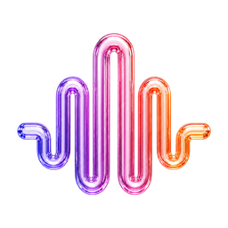

<div align="center">
  
  <h1>Neuron Flame</h1>
  <p><i>Voice-to-text at the speed of thought.</i></p>

  [](https://www.gnu.org/licenses/gpl-3.0)
  
  
</div>

---

**Neuron Flame** is a private, on-device voice-to-text dictation app for macOS, by **[Ziva Studio](https://neuronflame.com)**. Hold a hotkey, speak, release — your words appear at the cursor in whatever app you're in. Designed for people who think faster than they type.

> *Neuron Flame* (Sanskrit: स्वर) — the tone, the note that turns sound into meaning. Named after my daughter, Ziva.
> — Barney Sharma

## What it does

- **Push-to-talk dictation** — global hotkey, paste at cursor in any app
- **100% on-device transcription** — your voice never leaves your Mac
- **Local Whisper + NVIDIA Parakeet** models (and any OpenAI-compatible cloud provider if you want)
- **AI enhancement** — pass the raw transcript through Gemini / OpenAI / Anthropic / Ollama / a local CLI to clean up grammar, format as email/chat/code, etc.
- **Power Mode** — auto-swap settings per app (casual tone in Slack, email tone in Mail, verbatim in your code editor)
- **Personal records dashboard** — track WPM vs. typing, time saved, your dictation pace against the world record (Barbara Blackburn, 212 WPM sustained)
- **Custom dictionary** — name corrections, technical jargon, your own spelling preferences
- **Liquid Glass UI** — native macOS 26 Tahoe design language, with graceful fallback to ultra-thin material on macOS 14/15

## Install

1. Download the latest `.dmg` from [Releases](https://github.com/barney-cmyk/svara/releases)
2. Open the DMG → drag Neuron Flame to Applications
3. **First launch**: right-click Neuron Flame → Open → Open (one-time, because the app is self-signed not Apple-notarized)
4. Grant Microphone + Accessibility when prompted
5. Pick a model on the AI Models tab — **Parakeet V2** is the default (474 MB, English-only, fastest)
6. Set your hotkey on the Settings tab

That's it. Hold the hotkey, speak, release.

## Build from source

```bash
git clone https://github.com/barney-cmyk/svara.git
cd svara
brew install cmake     # required by whisper.cpp
make local             # builds in ~/Downloads/Neuron Flame.app
```

Requires Xcode 26+ for the macOS 26 SDK (Liquid Glass APIs).

## Privacy

- All transcription is local by default. Your voice never leaves the Mac.
- Optional cloud LLMs for AI enhancement run only if you configure an API key.
- Optional clipboard / window-context capture for accuracy: processed locally, sent only to your chosen LLM, never written to disk.
- No telemetry. No analytics. No phone-home.

## Credits

Neuron Flame is a fork of an upstream open-source voice-to-text project — the original copyright notice is preserved in [LICENSE](LICENSE) per GPL-3 terms. Open-source dependencies:

- [whisper.cpp](https://github.com/ggerganov/whisper.cpp) — local speech-to-text inference
- [FluidAudio](https://github.com/FluidInference/FluidAudio) — NVIDIA Parakeet on Apple Neural Engine
- [Sparkle](https://github.com/sparkle-project/Sparkle) — auto-update framework
- [KeyboardShortcuts](https://github.com/sindresorhus/KeyboardShortcuts) — global hotkey registration

## License

GPL-3.0. See [LICENSE](LICENSE) for the full text and the original upstream copyright notice.

If you distribute the binary, you must also make this source available — that's what GPL-3 requires, and it's why this repository is public.

---

Made by **Barney Sharma** in Australia, for Ziva. ❤️
